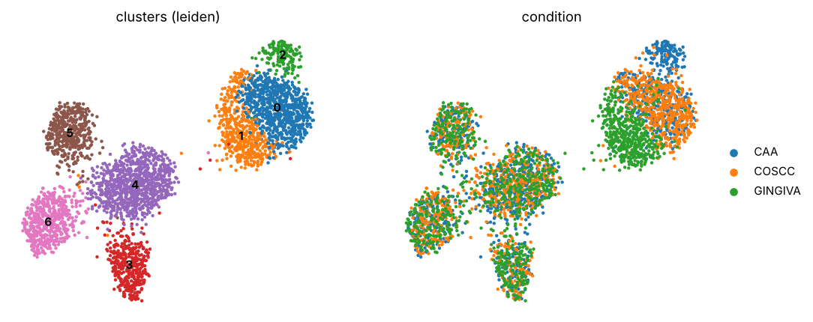
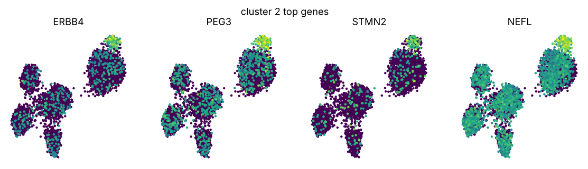
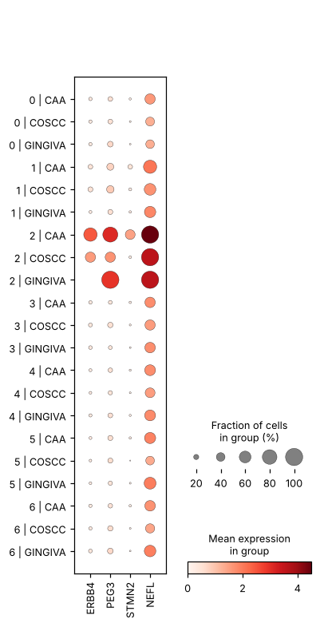

# Target discovery report — CAA vs COSCC, GINGIVA

Run `agent_synthetic` · 2026-10-12 13:05 · model(s): scripted · tokens in/out: 0/0 · 20 tool calls

> **Read this first.** Every number below was produced by a deterministic tool call recorded in `run.jsonl`; the model chose which tools to run and wrote the interpretation. Candidates are hypotheses for wet-lab validation, not conclusions. Druggability values marked *fixture* come from bundled illustrative data, not a live database.

## 1. Dataset

- 3,600 cells × 1,467 genes · species `homo_sapiens` · conditions: CAA (1,200), COSCC (1,200), GINGIVA (1,200)
- samples per condition: CAA: 3, COSCC: 3, GINGIVA: 3 (pseudonymized S01…)
- existing annotations: cell_type; clustering used: `leiden` (reused existing 'leiden', harmony=False)

## 2. Summary of nominations

| Gene | State (cluster) | Score | Known inhibitors | Nominator confidence | Critic flags |
|---|---|---|---|---|---|
| ERBB4 | 2 | 0.976 | NERATINIB, AFATINIB, LAPATINIB | high | – |
| SNAP25 | 2 | 0.719 | BOTULINUM TOXIN TYPE A | medium | – |
| DLG4 | 2 | 0.583 | – | medium | – |

**Analysis plan.** Reuse the existing clustering if the object is processed, otherwise QC + integrate. Find disease-enriched clusters by per-sample differential abundance, characterise them against sibling clusters of the same cell type, then nominate druggable, state-specific genes and have the critic test for single-sample and pan-condition artefacts.

**Critic summary.** Raised 0 flag(s). Candidates without flags are supported by replicate-aware DE, cluster specificity and consistency across disease samples; treat all nominations as hypotheses for IHC / pharmacologic validation.

## 3. Disease-specific cell states

Per-sample differential abundance (cluster key `leiden`); enriched clusters: **2**.

| Cluster | Cells | Mean prop. disease | Mean prop. reference | log2 ratio | MWU p | Disease samples present | Enriched |
|---|---|---|---|---|---|---|---|
| 2 | 150 | 0.114 | 0.005 | 4.166 | 0.028 | 3 | True |
| 4 | 875 | 0.263 | 0.233 | 0.176 | 0.300 | 3 | False |
| 6 | 521 | 0.154 | 0.140 | 0.138 | 0.548 | 3 | False |
| 0 | 785 | 0.227 | 0.214 | 0.084 | 1.000 | 3 | False |
| 5 | 420 | 0.116 | 0.117 | -0.015 | 1.000 | 3 | False |
| 3 | 370 | 0.092 | 0.108 | -0.220 | 0.795 | 3 | False |
| 1 | 479 | 0.033 | 0.183 | -2.421 | 0.048 | 3 | False |

### Cluster 2: disease-enriched keratinocyte state

Cluster 2 has log2 abundance ratio 4.166 (disease vs reference, per-sample), present in 3/3 disease samples; 91% of its cells come from the disease condition. Pseudobulk DE vs sibling clusters yields 10 significantly up-regulated genes (method: pydeseq2). Top genes: ERBB4, PEG3, STMN2, NEFL, RAB3A, SYT1, SYP, GAP43.

_Confidence: high; dominant cell type: keratinocyte._

**Pseudobulk DE vs sibling clusters** (pydeseq2; replicates target=3, reference=9; 10 up / 0 down at padj<0.05). Top up-regulated:

| Gene | log2FC | padj | baseMean |
|---|---|---|---|
| ERBB4 | 4.060 | 1.5e-71 | 59.892 |
| PEG3 | 3.684 | 2.6e-82 | 92.861 |
| STMN2 | 3.444 | 9.0e-32 | 27.238 |
| NEFL | 3.387 | 3.8e-98 | 279.552 |
| RAB3A | 3.270 | 1.4e-57 | 100.771 |
| SYT1 | 3.224 | 3.0e-45 | 164.338 |
| SYP | 3.141 | 1.4e-66 | 150.559 |
| GAP43 | 3.085 | 2.4e-54 | 339.964 |
| DLG4 | 2.929 | 4.6e-32 | 48.352 |
| SNAP25 | 2.703 | 1.0e-71 | 242.624 |

**Cell-level markers** (2 vs 0,1):

| Gene | log2FC | padj | % in | % out |
|---|---|---|---|---|
| NEFL | 4.433 | 1.1e-67 | 1.000 | 0.498 |
| GAP43 | 3.975 | 8.3e-62 | 0.993 | 0.596 |
| SNAP25 | 3.631 | 1.1e-50 | 0.953 | 0.540 |
| SYT1 | 4.176 | 2.1e-50 | 0.913 | 0.369 |
| SYP | 4.045 | 7.8e-45 | 0.880 | 0.344 |
| PEG3 | 4.642 | 1.0e-44 | 0.807 | 0.195 |
| RAB3A | 4.215 | 6.1e-41 | 0.807 | 0.243 |
| ERBB4 | 4.688 | 1.9e-33 | 0.693 | 0.114 |
| DLG4 | 3.319 | 1.7e-17 | 0.573 | 0.154 |
| STMN2 | 3.811 | 2.3e-12 | 0.440 | 0.066 |

**Enrichment (ORA):**

| Term | Overlap | Set size | padj | Genes |
|---|---|---|---|---|
| MINI_NEURONAL_SYNAPTIC_SIGNALING | 8 | 8 | 1.7e-19 | DLG4, GAP43, NEFL, RAB3A, SNAP25, STMN2, SYP, SYT1 |
| MINI_ERBB_SIGNALING | 1 | 3 | 0.020 | ERBB4 |

## 4. Target ranking

**Cluster 2** — score = weighted sum of effect size, specificity, druggability, known compounds, sample consistency (weights in `config_used.json`).

| # | Gene | Human | Score | log2FC | log2 spec. | Consistency | Druggable | Compounds | Inhibitors | Flags |
|---|---|---|---|---|---|---|---|---|---|---|
| 1 | ERBB4 | ERBB4 | 0.976 | 4.060 | 3.621 | 1.000 | 1.000 | 1.000 | NERATINIB, AFATINIB, LAPATINIB, DACOMITINIB, IBRUTINIB | – |
| 2 | SNAP25 | SNAP25 | 0.719 | 2.703 | 2.393 | 1.000 | 1.000 | 0.333 | BOTULINUM TOXIN TYPE A | – |
| 3 | DLG4 | DLG4 | 0.583 | 2.929 | 2.401 | 1.000 | 0.600 | 0.000 | – | no_known_compounds |
| 4 | PEG3 | PEG3 | 0.542 | 3.684 | 3.384 | 1.000 | 0.000 | 0.000 | – | not_druggable, no_known_compounds |
| 5 | STMN2 | STMN2 | 0.504 | 3.444 | 3.023 | 1.000 | 0.000 | 0.000 | – | not_druggable, no_known_compounds |
| 6 | EGFR | EGFR | 0.500 | 0.000 | -0.220 | 1.000 | 1.000 | 1.000 | ERLOTINIB, GEFITINIB, OSIMERTINIB, CETUXIMAB, AFATINIB, NERATINIB | low_specificity, shared_across_conditions |
| 7 | RAB3A | RAB3A | 0.496 | 3.270 | 3.073 | 1.000 | 0.000 | 0.000 | – | not_druggable, no_known_compounds |
| 8 | SYT1 | SYT1 | 0.489 | 3.224 | 2.995 | 1.000 | 0.000 | 0.000 | – | not_druggable, no_known_compounds |
| 9 | NEFL | NEFL | 0.486 | 3.387 | 2.784 | 1.000 | 0.000 | 0.000 | – | not_druggable, no_known_compounds |
| 10 | SYP | SYP | 0.474 | 3.141 | 2.849 | 1.000 | 0.000 | 0.000 | – | not_druggable, no_known_compounds |
| 11 | GAP43 | GAP43 | 0.467 | 3.085 | 2.780 | 1.000 | 0.000 | 0.000 | – | not_druggable, no_known_compounds |
| 12 | KRAS | KRAS | 0.460 | 0.000 | 0.152 | 1.000 | 1.000 | 0.667 | SOTORASIB, ADAGRASIB | low_specificity |
| 13 | TOP2A | TOP2A | 0.457 | 0.000 | 0.104 | 1.000 | 1.000 | 0.667 | DOXORUBICIN, ETOPOSIDE | low_specificity, shared_across_conditions |
| 14 | CCND1 | CCND1 | 0.300 | 0.000 | -0.085 | 1.000 | 0.600 | 0.333 | PALBOCICLIB | low_specificity |
| 15 | MKI67 | MKI67 | 0.102 | 0.000 | 0.024 | 1.000 | 0.000 | 0.000 | – | low_specificity, shared_across_conditions, not_druggable, no_known_compounds |

Druggability sources used: fixture, none.

**Literature (PubMed hit counts):** ERBB4: None; PEG3: None; RAB3A: None; STMN2: None; SYT1: None; SYP: None; NEFL: None; GAP43: None; DLG4: None; SNAP25: None

## 5. Critic review

_No flags raised._

## 6. Agent notes

**planner:** Plan recorded.

**analyst:** Done.

**target:** Nominated 3 candidate targets for cluster 2.

**critic:** Critic review complete.

## 7. Provenance

20 tool calls, 24 model calls. Full log: `run.jsonl`; tables: `tables/`; state: `state.json`.

| # | Role | Tool | Arguments | Error |
|---|---|---|---|---|
| 4 | planner | load_dataset | {} |  |
| 6 | planner | record_finding | {"kind": "summary", "title": "Analysis plan", "detail": "Reuse the existing clustering if  |  |
| 11 | analyst | load_dataset | {} |  |
| 13 | analyst | integrate_and_cluster | {"reuse_existing": "leiden", "use_harmony": false, "resolution": 1.0, "n_pcs": 30} |  |
| 15 | analyst | cluster_composition | {} |  |
| 17 | analyst | differential_abundance | {"enrichment_log2fc": 1.0} |  |
| 19 | analyst | find_markers | {"cluster": "2", "reference_clusters": ["0", "1"], "n_top": 30} |  |
| 21 | analyst | pseudobulk_de | {"cluster": "2", "reference_clusters": ["0", "1"], "n_top": 40} |  |
| 23 | analyst | enrichment | {"genes": ["ERBB4", "PEG3", "STMN2", "NEFL", "RAB3A", "SYT1", "SYP", "GAP43", "DLG4", "SNA |  |
| 25 | analyst | plot_genes | {"genes": ["ERBB4", "PEG3", "STMN2", "NEFL"], "title": "cluster 2 top genes"} |  |
| 27 | analyst | record_finding | {"kind": "disease_state", "title": "Cluster 2: disease-enriched keratinocyte state", "deta |  |
| 32 | target | gene_specificity | {"genes": ["ERBB4", "PEG3", "STMN2", "NEFL", "RAB3A", "SYT1", "SYP", "GAP43", "DLG4", "SNA |  |
| 34 | target | druggability_lookup | {"genes": ["ERBB4", "PEG3", "RAB3A", "STMN2", "SYT1", "SYP", "NEFL", "GAP43", "DLG4", "SNA |  |
| 36 | target | literature_count | {"genes": ["ERBB4", "PEG3", "RAB3A", "STMN2", "SYT1", "SYP", "NEFL", "GAP43", "DLG4", "SNA |  |
| 38 | target | score_targets | {"genes": ["ERBB4", "PEG3", "RAB3A", "STMN2", "SYT1", "SYP", "NEFL", "GAP43", "DLG4", "SNA |  |
| 40 | target | record_finding | {"kind": "candidate_target", "title": "ERBB4 (rank 1, score 0.9763)", "detail": "log2FC 4. |  |
| 42 | target | record_finding | {"kind": "candidate_target", "title": "SNAP25 (rank 2, score 0.7185)", "detail": "log2FC 2 |  |
| 44 | target | record_finding | {"kind": "candidate_target", "title": "DLG4 (rank 3, score 0.5831)", "detail": "log2FC 2.9 |  |
| 49 | critic | differential_abundance | {"within_celltype": true} |  |
| 51 | critic | record_finding | {"kind": "summary", "title": "Critic summary", "detail": "Raised 0 flag(s). Candidates wit |  |
