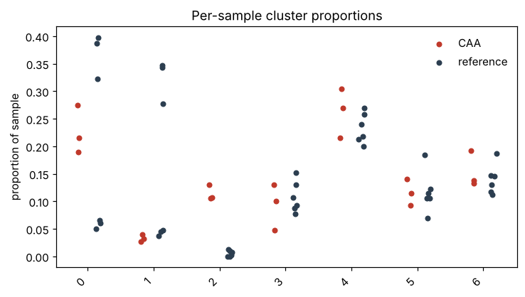

# Target discovery report — CAA vs COSCC, GINGIVA

Run `baseline_synthetic` · 2026-10-12 13:05 · model(s): – · tokens in/out: 0/0 · 0 tool calls

> **Read this first.** Every number below was produced by a deterministic tool call recorded in `run.jsonl`; the model chose which tools to run and wrote the interpretation. Candidates are hypotheses for wet-lab validation, not conclusions. Druggability values marked *fixture* come from bundled illustrative data, not a live database.

## 1. Dataset

- 3,600 cells × 1,467 genes · species `homo_sapiens` · conditions: CAA (1,200), COSCC (1,200), GINGIVA (1,200)
- samples per condition: CAA: 3, COSCC: 3, GINGIVA: 3 (pseudonymized S01…)
- existing annotations: cell_type; clustering used: `leiden` (reused existing 'leiden', harmony=False)

## 2. Summary of nominations

| Gene | State (cluster) | Score | Known inhibitors | Nominator confidence | Critic flags |
|---|---|---|---|---|---|
| ERBB4 | 2 | 4.755 | NERATINIB, AFATINIB, LAPATINIB | – | – |
| SNAP25 | 2 | 3.575 | BOTULINUM TOXIN TYPE A | – | – |
| DLG4 | 2 | 3.312 | – | – | – |
| KRAS | 2 | 2.732 | SOTORASIB, ADAGRASIB | – | – |
| TOP2A | 2 | 2.500 | DOXORUBICIN, ETOPOSIDE | – | – |

## 3. Disease-specific cell states

Per-sample differential abundance (cluster key `leiden`); enriched clusters: **2**.

| Cluster | Cells | Mean prop. disease | Mean prop. reference | log2 ratio | MWU p | Disease samples present | Enriched |
|---|---|---|---|---|---|---|---|
| 2 | 150 | 0.114 | 0.005 | 4.166 | 0.028 | 3 | True |
| 4 | 875 | 0.263 | 0.233 | 0.176 | 0.300 | 3 | False |
| 6 | 521 | 0.154 | 0.140 | 0.138 | 0.548 | 3 | False |
| 0 | 785 | 0.227 | 0.214 | 0.084 | 1.000 | 3 | False |
| 5 | 420 | 0.116 | 0.117 | -0.015 | 1.000 | 3 | False |
| 3 | 370 | 0.092 | 0.108 | -0.220 | 0.795 | 3 | False |
| 1 | 479 | 0.033 | 0.183 | -2.421 | 0.048 | 3 | False |

### Cluster 2 (baseline)

most disease-enriched cluster by log2 ratio

_Confidence: None; dominant cell type: keratinocyte._

**Cell-level markers** (2 vs rest):

| Gene | log2FC | padj | % in | % out |
|---|---|---|---|---|
| NEFL | 4.273 | 2.5e-69 | 1.000 | 0.512 |
| GAP43 | 3.977 | 3.5e-65 | 0.993 | 0.586 |
| SYT1 | 4.158 | 4.6e-53 | 0.913 | 0.367 |
| SNAP25 | 3.575 | 4.6e-53 | 0.953 | 0.544 |
| PEG3 | 4.746 | 2.2e-48 | 0.807 | 0.183 |
| SYP | 4.035 | 1.5e-47 | 0.880 | 0.342 |
| RAB3A | 4.206 | 1.9e-43 | 0.807 | 0.241 |
| ERBB4 | 4.755 | 4.1e-36 | 0.693 | 0.109 |
| MKI67 | 2.604 | 8.1e-36 | 0.980 | 0.739 |
| PKP1 | 3.181 | 3.1e-34 | 0.967 | 0.604 |

## 4. Target ranking

**Cluster 2** — score = weighted sum of effect size, specificity, druggability, known compounds, sample consistency (weights in `config_used.json`).

| # | Gene | Human | Score | log2FC | log2 spec. | Consistency | Druggable | Compounds | Inhibitors | Flags |
|---|---|---|---|---|---|---|---|---|---|---|
| 1 | ERBB4 | ERBB4 | 4.755 | 4.755 | – | – | 1.000 | 0.000 | NERATINIB, AFATINIB, LAPATINIB, DACOMITINIB, IBRUTINIB | – |
| 2 | SNAP25 | SNAP25 | 3.575 | 3.575 | – | – | 1.000 | 0.000 | BOTULINUM TOXIN TYPE A | – |
| 3 | DLG4 | DLG4 | 3.312 | 3.312 | – | – | 1.000 | 0.000 | – | – |
| 4 | KRAS | KRAS | 2.732 | 2.732 | – | – | 1.000 | 0.000 | SOTORASIB, ADAGRASIB | – |
| 5 | TOP2A | TOP2A | 2.500 | 2.500 | – | – | 1.000 | 0.000 | DOXORUBICIN, ETOPOSIDE | – |
| 6 | CCND1 | CCND1 | 2.346 | 2.346 | – | – | 1.000 | 0.000 | PALBOCICLIB | – |
| 7 | EGFR | EGFR | 2.147 | 2.147 | – | – | 1.000 | 0.000 | ERLOTINIB, GEFITINIB, OSIMERTINIB, CETUXIMAB, AFATINIB, NERATINIB | – |
| 8 | PEG3 | PEG3 | 0.949 | 4.746 | – | – | 0.000 | 0.000 | – | – |
| 9 | NEFL | NEFL | 0.855 | 4.273 | – | – | 0.000 | 0.000 | – | – |
| 10 | RAB3A | RAB3A | 0.841 | 4.206 | – | – | 0.000 | 0.000 | – | – |
| 11 | SYT1 | SYT1 | 0.832 | 4.158 | – | – | 0.000 | 0.000 | – | – |
| 12 | SYP | SYP | 0.807 | 4.035 | – | – | 0.000 | 0.000 | – | – |
| 13 | GAP43 | GAP43 | 0.795 | 3.977 | – | – | 0.000 | 0.000 | – | – |
| 14 | STMN2 | STMN2 | 0.795 | 3.976 | – | – | 0.000 | 0.000 | – | – |
| 15 | PKP1 | PKP1 | 0.636 | 3.181 | – | – | 0.000 | 0.000 | – | – |

Druggability sources used: fixture, none.

## 5. Critic review

_No flags raised._

## 6. Agent notes

## 7. Provenance

0 tool calls, 0 model calls. Full log: `run.jsonl`; tables: `tables/`; state: `state.json`.

_none_
